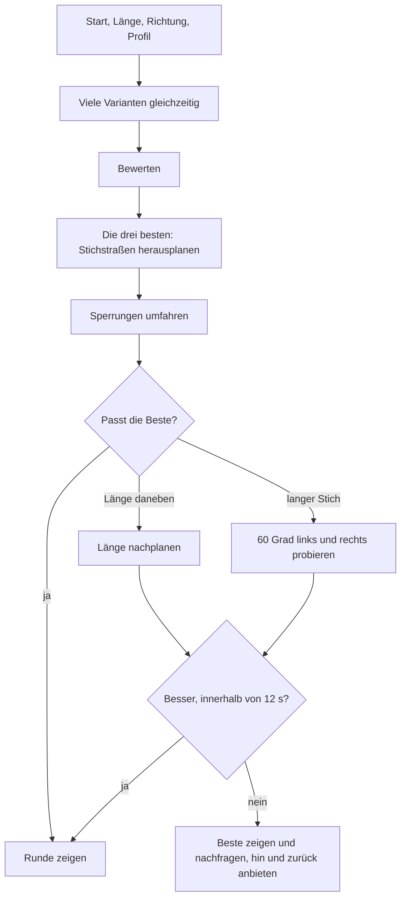

# So plant CUMO DRIVE

Stand: 19. November 2026. Zusammenfassung für Koray, aus dem Code und den Routen Checks. Maßgeblich bleibt der Code: `app/src/lib/cumo-routing.ts`, `plan.ts`, `smart-roundtrip.ts` und die Profile in `routing/server/custom_models`. Die Zahlen ändern sich mit den Routen Checks, dieses Dokument wird dann nachgezogen.

## Der Gedanke in drei Sätzen

Jede Straße hat einen Preis. Was ein Sportwagenfahrer mag (Kurven, Breite, guter Belag, keine Orte, unsere Traumstrecken), macht eine Straße billig, alles andere teuer. Die Planung sucht den billigsten Weg, und bei der Rundtour zusätzlich die beste aus vielen Varianten.

## 1. Was eine Straße kostet

Der eigene Routing Server (GraphHopper, zwei Server, DACH, Norditalien, Ostfrankreich, Slowenien) rechnet mit diesen Gewichten. Ein Faktor unter 1 macht die Straße teurer, 0 sperrt sie.

| Merkmal | Kurvig | Sehr kurvig |
|---|---|---|
| Breite unter 1,9 m | gesperrt | gesperrt |
| Breite unter 3 m | 0,1 | 0,1 |
| Breite 3 bis 4,5 m | 0,85 | 0,6 |
| Bundesstraße (primary) | 0,35, nur außerorts | 0,2 |
| Landesstraße (secondary) | 0,7, nur außerorts | 0,55 |
| Wohnstraße | 0,5 | 0,4 |
| Fast gerade | 0,3 | 0,15 |
| Wenig Kurven | 0,6 | 0,4 |

Dazu kommt bei jeder Anfrage aus der App:

| Zusatz | Wirkung |
|---|---|
| Traumstrecken | Um die kuratierten Strecken liegt ein Korridor. Alles außerhalb kostet mit Faktor 0,7 mehr |
| Großstädte | Faktor 0,4, deutlich teurer, aber nicht verboten |
| Vermeiden | Sperrungen und rauer Belag sind an, Fähren und Maut aus (einstellbar) |
| Gemiedene Pässe | Was du als gemieden markierst, wird gesperrt |

Autobahnen haben im Profil Kurvig keine eigene Regel. Sie sind gerade und fallen darüber heraus. In 44 Vergleichsfällen am 19.11. hatten die Rundtouren 0 km Autobahn.

Das Profil **Schnell** kennt nur die Breite und sucht sonst den schnellsten Weg. Es ist für Anfahrten gedacht.

## 2. Route von A nach B

1. **Profil je Etappe.** Kurvig, Sehr kurvig oder Schnell, für jede Etappe einzeln.
2. **Kurvig oder direkt.** Für jede kurvige Etappe rechnet die App auch den direkten Weg. Lohnt der Umweg nicht, gilt dort der direkte Weg. Die Entscheidung fällt je Etappe, damit ein anderes Ziel nicht die ganze Tour kippt. Sehr lange Etappen werden nicht verglichen.
3. **Am Stück planen.** Aufeinander folgende Etappen mit demselben Profil werden zusammen geplant, damit am Zwischenziel nicht gewendet wird.
4. **Etappen Check.** Die fertige Route wird gegen die Straßendaten geprüft: Breite, Belag, Sperrungen. Gesperrtes wird umfahren, Zweifelsfälle bekommen den Hinweis „prüfen“.
5. **Wintersperren.** Beim Planen im Voraus informieren sie nur. Unterwegs wird umfahren.
6. **Ergebnis.** Strecke, Fahrzeit, Kurven, Highlights nach Fahrspaß, Höhenprofil, Stopps.

## 3. Rundtour (Schnelle Runde)

### Schritt 1: Varianten
Alle gleichzeitig, vom eigenen Server:

* **Freie Runden:** bei Zufall in sechs Richtungen, sonst fünf in der gewählten Richtung.
* **Runden über Traumstrecken:** Stützpunkte auf kuratierten Strecken in der Nähe.
* **Kreisrunden:** Stützpunkte auf einem Kreis, bevorzugt im hügeligen Gelände.
* **Pass Runden:** über Pässe im Umkreis.

### Schritt 2: Bewertung
Jede Variante bekommt Punkte.

| Plus | Minus |
|---|---|
| Kurven und kurviger Anteil | Länge neben dem Wunsch |
| Traumstrecken, 4 Punkte je km | Orte auf der Strecke |
| Highlights und Pässe | Runde liegt nicht in der gewählten Richtung |
| Fahrregionen | Gesperrte km (40 je km), Prüfstellen (20), kleine Straßen ohne Nummer (12) |
| | Schon gezeigte Runde (400), damit Neu würfeln Neues bringt |

### Schritt 3: Stichstraßen
Eine Stichstraße ist ein Stück, das man hin und auf demselben Weg zurück fährt. Die drei besten Varianten werden ohne ihre Stichstraßen neu geplant. Was danach bleibt, kostet 300 Punkte je km. Der Bereich direkt um den Start zählt nicht.

### Schritt 4: Sperrungen
Aktuelle Verkehrsmeldungen im Umkreis werden geholt, betroffene Runden um die Sperrung herum neu geplant.

### Schritt 5: Nacharbeit, höchstens 12 Sekunden
Seit 19.11. gilt ein gemeinsames Zeitbudget, vorher dauerte das in Alpentälern bis zu 50 Sekunden.

* **Länge passt nicht** (unter 70 % oder über 130 % des Wunsches): bis zu drei Versuche mit anderem Radius. Kommt zuerst dran.
* **Langer Stich** (über 3 km oder 6 % der Länge): dieselbe Planung 60 Grad nach links und rechts. Eine gedrehte Runde gewinnt nur, wenn sie klar besser ist.
* **Gar keine Runde in der Richtung:** drei andere Richtungen (90 Grad links, rechts und Gegenrichtung).

### Schritt 6: Rückfrage
Passt die Länge am Ende nicht oder bleiben über 5 km Stich, zeigt die App die beste Runde, sagt warum und bietet die Tour als hin und zurück an. Typisch in Tälern ohne zweiten Ausgang, vor allem bei Wintersperren.

### Feste Regeln nur für Rundtouren
* **Fréjus und Mont Blanc Tunnel sind gesperrt** (seit 19.11.). Lange, teure Mauttunnel sind kein Genuss. Bei Routen von A nach B bleiben sie erlaubt.
* **Maut an sich ist erlaubt.** Viele der schönsten Pässe kosten Maut.

## 4. Wenn der eigene Server nicht antwortet

1. Die App wechselt auf den zweiten eigenen Server.
2. Sind beide nicht erreichbar, plant sie über einen öffentlichen Ersatzdienst (Valhalla). Die Ergebnisse sind dann weniger kurvig und ohne Ortsdichte. Bei Rundtouren werden Stützpunkte, die Stichstraßen erzeugen, weggelassen und neu gerechnet, höchstens dreimal.

Strecken, Pässe und Empfehlungen liegen in der App und brauchen dafür kein Netz.

## 5. Highlights und Fahrspaß

* **Pässe** aus der Passdatenbank, vom Talpunkt bis zum Talpunkt.
* **Kuratierte Strecken** werden angesagt, wenn Anfang und Ende höchstens 120 m neben der Route liegen und 70 % der Strecke befahren wird.
* Liegt eine Passhöhe auf einer Strecke, gewinnt die Strecke, außer der Pass ist eine Ikone.
* **Fahrspaß Pegel** in fünf Stufen: Nett, Lohnend, Stark, Traumstraße, Legende.

## 6. Unterwegs

* **Falsch abgebogen:** Die App führt zurück auf die Tour.
* **Nah am Ziel** (Rest höchstens 3 km, oder Ziel in 1,5 km Luftlinie und Rest höchstens 10 km, oder der direkte Weg ist höchstens eine Minute langsamer): Sie führt direkt zum Ziel.
* **Restzeit:** passt sich laufend deinem tatsächlichen Tempo an.

## 7. Wie wir das prüfen

* **Routen Check, täglich:** 25 Routen (feste Fälle, Rundtouren, Passstrecken), mit Befunden zu Länge, Orten, Stichen, Schleifen und Planungszeit.
* **Vor jedem Update:** alle festen Routen und die Bedienfolgen im Planer müssen grün sein.
* **Änderungen an Gewichten** werden vorher und nachher an denselben Fällen gemessen.

## Was wir bewusst nicht tun, und warum

| Idee | Warum nicht |
|---|---|
| Maut generell meiden | Großglockner, Timmelsjoch und andere Ikonen kosten Maut |
| Tunnel und Autobahn im Profil Kurvig allgemein abwerten | Gemessen am 19.11.: kaum Nutzen, aber Innsbruck 140 km verlor Kesselberg und Seefelder Sattel, und Bozen 200 km verlor bei starker Tunnel Abwertung Karerpass, Nigerpass und Pordoijoch. Das Modell kennt keine Tunnellänge |
| Straßen außerhalb der Fahrregionen auf dem Server abwerten | Machte die Planung fast doppelt so langsam, ohne mehr Fahrspaß |
| Großer Sankt Bernhard Tunnel sperren | Tunnel und Passstraße liegen zu dicht beieinander, die Sperre träfe beide |

## Bekannte Schwächen (Stand 19.11.)

* **Täler ohne Ausgang im Winter** (Bonneval, Linthal, Valloire, Sölden): Runden werden viel länger als gewünscht, die App fragt nach.
* **Lugano und Sottoceneri:** zu wenige kuratierte Strecken, Runden zu lang und durch Uferorte.
* **Bonneval:** schon die erste Planung dauert 16 bis 22 Sekunden.
* **Chur, Küblis:** ein Schlenker von etwa 1 km.
* **Bensheim 120 km:** 37 % Orte.
